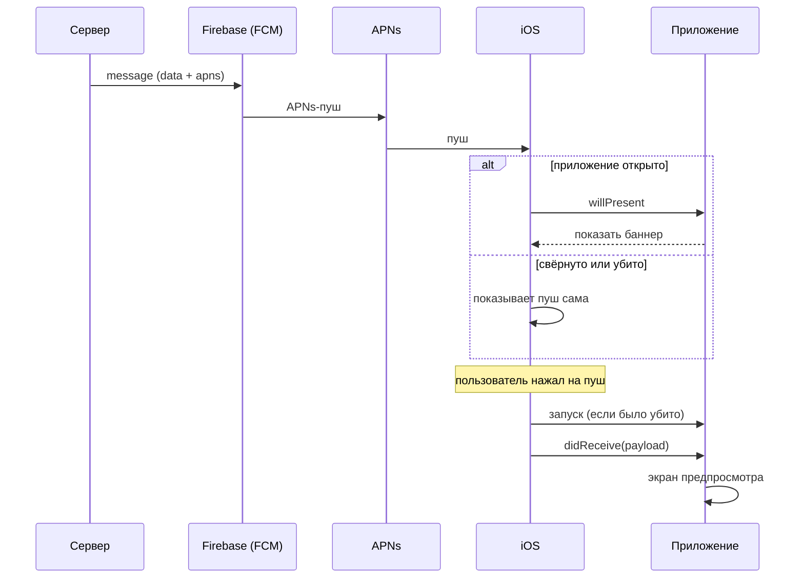

# PushWakeUpDemo

[English](README.md) · **Русский**

Демо-приложение для iOS: как пуш о звонке (например, с домофона) доставляет данные
в приложение и как приложение «просыпается».

Цель — показать **механику пробуждения**, а не сам звонок. SIP, видео и открытие двери
остаются за рамками: к моменту, когда приложение разбужено и получило payload,
дальше уже идёт обычная логика звонка.

Материалов по этой теме мало, поэтому код и описание сделаны максимально подробными.

## Содержание

- [Что уже есть и что будет](#что-уже-есть-и-что-будет)
- [Как работают обычные пуши](#как-работают-обычные-пуши)
- [Payload](#payload)
- [Структура проекта](#структура-проекта)
- [Запуск](#запуск)
- [Проверка на симуляторе без сервера](#проверка-на-симуляторе-без-сервера)
- [Проверка на iPhone через Firebase](#проверка-на-iphone-через-firebase)
- [Частые вопросы](#частые-вопросы)

## Что уже есть и что будет

| Этап | Что показывает | Статус |
|---|---|---|
| 1 | Обычный пуш (Firebase): payload, баннер при открытом приложении, нажатие → экран предпросмотра, холодный старт | ✅ |
| 2 | Кнопки в пуше («Ответить» / «Отклонить») и реакция на смахивание | ✅ |
| 3 | Изменение пуша на устройстве: Notification Service Extension | ✅ |
| 4 | VoIP-пуш: PushKit + CallKit — пробуждение приложения без участия пользователя | ✅ |
| 5 | Настройки: вкл/выкл VoIP, статус разрешения на уведомления | ⏳ |

## Как работают обычные пуши

Главное: **обычный пуш сам приложение не будит.** Пока пользователь не нажал на пуш,
приложение о нём не знает (если оно не было открыто).

| Ситуация | Что происходит |
|---|---|
| Пуш пришёл, приложение **открыто** | iOS вызывает `willPresent` и спрашивает, как показать пуш. Демо пишет в журнал и отвечает «покажи баннер». Экран само не открывает. |
| Пуш пришёл, приложение **свёрнуто или убито** | Пуш показывает iOS. Приложение не запускается и ничего не знает. |
| Пользователь **нажал на пуш** | Если приложение было убито, iOS запускает его (`didFinishLaunching`), затем вызывает `didReceive` с payload → открывается экран предпросмотра. |
| Пользователь открыл приложение **с иконки** | Пуш в приложение не передаётся — остаётся в центре уведомлений. |
| Бейдж на иконке | Ставится из `"badge": 1`. Сам не пропадает — приложение сбрасывает его при открытии. |



Подробный разбор с комментариями — в `PushWakeUpDemo/App/AppDelegate+NotificationHandling.swift`.

## Кнопки в пуше и смахивание (этап 2)

В payload сервер присылает только **имя категории**: `"category": "CALL_NOTIFICATION"`.
Сами кнопки в пуш не передаются — приложение при запуске сообщает iOS, какие кнопки есть
у этой категории (`PushWakeUpDemo/Push/CallNotificationCategory.swift`). После этого iOS
показывает их сама, даже если приложение убито.

Кнопки видны при **долгом нажатии** на пуш, а на экране блокировки — после свайпа влево → **«Смотреть»**.

| Действие | Опция | Что делает iOS | Что в журнале |
|---|---|---|---|
| Нажали на пуш | — | Открывает приложение | «Нажали на пуш звонка» → экран предпросмотра |
| **«Ответить»** | `.foreground` | Открывает приложение (просит разблокировать телефон) | «Нажали «Ответить» в пуше» → экран предпросмотра |
| **«Отклонить»** | без `.foreground`, `.destructive` (красная) | Будит приложение **в фоне**, экран не открывается, телефон остаётся заблокирован | «Нажали «Отклонить» в пуше» · `в фоне` |
| **Смахнули** (свайп влево → «Очистить») | `.customDismissAction` у категории | Будит приложение **в фоне** | «Пуш смахнули» · `в фоне` |

Все действия приходят в один метод `didReceive` — различаются по `response.actionIdentifier`:
`UNNotificationDefaultActionIdentifier` (нажатие), `CALL_ANSWER`, `CALL_DECLINE`,
`UNNotificationDismissActionIdentifier` (смахнули).

Если приложение было убито, в журнале перед действием будет «Приложение запущено · холодный старт»:
`неактивно` — для нажатия и «Ответить», `в фоне` — для «Отклонить» и смахивания.

В фоне у приложения есть несколько секунд: в реальном приложении здесь сообщают серверу,
что звонок отклонён, и только потом вызывают `completionHandler`.

Без опции `.customDismissAction` смахивание проходит молча — приложение о нём не узнает.
Сворачивание баннера вверх (пока он висит сверху экрана) — это не смахивание: пуш остаётся
в центре уведомлений, и событие не приходит.

## Изменение пуша на устройстве (этап 3)

**Notification Service Extension (NSE)** — отдельный маленький процесс внутри приложения
(`NotificationService/`). iOS запускает его на каждый пуш **до того, как показать пуш**,
и даёт около 30 секунд поменять содержимое.

- Работает, даже если приложение убито. **Само приложение при этом не просыпается.**
- Запускается, только если в `aps` есть **`"mutable-content": 1`**. Без этого поля iOS показывает пуш как есть.
  В боевом payload поля нет — для этапа 3 сервер должен добавить ровно его
  (пример: `Scripts/payloads/fcm_call_nse.json`, отличие от `fcm_call.json` — одна строка).
- Если расширение не успело, iOS вызывает `serviceExtensionTimeWillExpire` и показывает то, что успели изменить.

Что делает расширение с пушем звонка (`type = sip_call`):

| Было (с сервера) | Стало |
|---|---|
| «Ожидайте звонка» / «Домофон: TEST» | «📞 Входящий звонок», подзаголовок «Домофон: TEST», подсказка про кнопки |
| `category` может не быть | `CALL_NOTIFICATION` — кнопки «Ответить» / «Отклонить» появятся всегда, даже у пуша из консоли Firebase |
| обычный пуш | **неотложный** (`timeSensitive`) — пробивает «Не беспокоить» и фокус |
| — | звук `customSound.wav`, стопка по `call_id` |
| — | в `userInfo` добавлено `nse_modified: 1` — видно в журнале приложения |

Расширение пишет в журнал «Расширение изменило пуш» (розовая иконка) с текстом «было / стало».
Чтобы оно могло писать в тот же журнал, журнал лежит в общем контейнере **App Group**
`group.com.churiqlab.PushWakeUpDemo` (до этапа 3 он был в UserDefaults приложения и переносится автоматически).

Код: `NotificationService/NotificationService.swift`. В расширение подключены и общие файлы приложения:
`EventLog.swift`, `PushNotificationData.swift`, `NotificationType.swift`, `CallNotificationCategory.swift`.

**Проверка — только на iPhone.** `xcrun simctl push` расширение не запускает (проверено на iOS 26.5).

```bash
./Scripts/send_fcm_push.sh <FCM-токен> Scripts/payloads/fcm_call_nse.json
```

1. Приложение убито → пуш приходит уже с текстом «📞 Входящий звонок» и меткой «Неотложное».
2. Откройте приложение: первая запись — «Расширение изменило пуш», состояние
   «расширение · отдельный процесс, приложение не будится». Записи «Приложение запущено» перед ней нет.
3. Для сравнения отправьте `fcm_call.json` (без `mutable-content`) — пуш придёт в исходном виде, записи от расширения не будет.

## VoIP-пуш: PushKit + CallKit (этап 4)

Единственный способ разбудить приложение **без участия пользователя**.

| | Обычный пуш (этапы 1–3) | VoIP-пуш (PushKit) |
|---|---|---|
| Приложение убито | Пуш показывает iOS, приложение спит | **iOS сразу запускает приложение** |
| Уведомления запрещены | Пуш не виден | **Работает всё равно** |
| Что видит пользователь | Баннер / экран блокировки | **Нативный экран звонка CallKit**, как у телефонного звонка |
| Кто отправляет | Firebase (FCM) | **APNs напрямую** — Firebase VoIP-пуши не отправляет |
| Токен | FCM-токен | **VoIP-токен** — отдельный, выдаёт PushKit |
| Условие iOS | — | На **каждый** VoIP-пуш сразу показать звонок в CallKit |

**Главное правило iOS:** получив VoIP-пуш, приложение обязано сразу вызвать
`CXProvider.reportNewIncomingCall` — до `completion` от PushKit. Иначе iOS убьёт приложение,
а после нескольких нарушений перестанет доставлять ему VoIP-пуши. Поэтому звонок в CallKit
показывается всегда, даже если payload странный.

Как это идёт в коде:

1. `didFinishLaunching` → `VoIPPushService.start()` — PushKit-реестр создаётся **при каждом запуске**:
   если приложение запустил VoIP-пуш, iOS отдаст его только после этого.
2. PushKit выдаёт **VoIP-токен** → главный экран, журнал, консоль Xcode (`VOIP_TOKEN=…`).
3. VoIP-пуш → «VoIP-пуш разбудил приложение» → `CallKitService.reportIncomingCall` →
   «Показан экран звонка CallKit».
4. **«Ответить»** → «Ответили в CallKit» → экран предпросмотра («Ответили на экране звонка CallKit»).
   Это видеозвонок (`hasVideo`), поэтому iOS сразу открывает приложение. Закрыли предпросмотр —
   звонок в CallKit завершается («Звонок завершён»).
5. **«Отклонить»** → «Звонок отклонён в CallKit» — здесь реальное приложение сообщает серверу.
6. Никто не ответил за 30 секунд → «Звонок пропущен».

Код: `PushWakeUpDemo/VoIP/VoIPPushService.swift` (PushKit), `PushWakeUpDemo/VoIP/CallKitService.swift` (CallKit),
связка — `PushWakeUpDemo/App/AppDelegate+VoIP.swift`. В `Info.plist` добавлен фоновый режим `voip`.

### Отправка VoIP-пуша: `Scripts/send_voip_push.sh`

Сервер шлёт VoIP-пуш в APNs сам, и скрипт делает ровно это: JWT, подписанный ключом `.p8` (ES256),
`apns-topic: com.churiqlab.PushWakeUpDemo.voip`, `apns-push-type: voip`.
Нужны только стандартные утилиты macOS: `curl`, `openssl`, `xxd`.

**Настройка (один раз):** положите ключ APNs — **тот же `.p8`, что загружен в Firebase**, —
в `Scripts/secrets/AuthKey_<KEY_ID>.p8`. Имя именно такое, как его скачивает Apple: Key ID скрипт берёт
из имени файла. Team ID берётся из проекта. Папка `Scripts/secrets/` и все `.p8` в `.gitignore`.

```bash
./Scripts/send_voip_push.sh <VoIP-токен>
```

- Payload: `Scripts/payloads/voip_call.json` — те же поля звонка в корне, `aps` пустой (VoIP-пуш ничего
  не показывает сам, экран рисует CallKit). Свой payload — вторым аргументом.
- Окружение: сборка из Xcode — `sandbox` (по умолчанию), TestFlight / App Store — `APNS_ENV=production`.
- Другое место ключа или имя: `APNS_KEY_FILE=…`, `APNS_KEY_ID=…`, `APNS_TEAM_ID=…`, `APNS_BUNDLE_ID=…`.
- `DRY_RUN=1` — показать, что будет отправлено.

| Ответ APNs | Причина |
|---|---|
| `BadDeviceToken` | Это не VoIP-токен, или не то окружение (sandbox / production) |
| `DeviceTokenNotForTopic` | Токен от другого приложения — например, вставили FCM-токен |
| `InvalidProviderToken` | Не тот Key ID / Team ID, или у ключа не включён APNs |
| `Unregistered` | Приложение удалено или переустановлено — возьмите новый токен |

### Проверка — только на iPhone

Симулятор не выдаёт VoIP-токен, а экран CallKit на нём сразу сбрасывается.

1. Запустите приложение на iPhone из Xcode → в журнале «VoIP-токен получен», токен — на главном экране
   и в консоли Xcode (`VOIP_TOKEN=…`).
2. **Смахните приложение** из многозадачности. Можно даже запретить уведомления в Настройках.
3. `./Scripts/send_voip_push.sh <VoIP-токен>` → на iPhone **сразу экран звонка CallKit** — «Домофон: TEST».
4. «Ответить» → приложение открывается с предпросмотром. В журнале:
   «Приложение запущено · в фоне · холодный старт» → «VoIP-пуш разбудил приложение» →
   «Показан экран звонка CallKit» → «Ответили в CallKit» → «Экран предпросмотра показан».
5. Ещё раз, но «Отклонить» → «Звонок отклонён в CallKit». И ещё раз — не отвечать 30 секунд → «Звонок пропущен».

## Payload

Так сервер отправляет пуш через **FCM HTTP v1** (`POST https://fcm.googleapis.com/v1/projects/<project-id>/messages:send`):

```
payload = {
        "message": {
            "token": "?",
            "data": {
                "service_url": "?",
                "panele_id": "?",
                "asterisk_url": "?",
                "addr": "TEST",
                "rtsp": "?",
                "type": "sip_call",
                "token": "?",
                "call_id": "?"
            },
            "apns": {
                "payload": {
                    "aps": {
                        "alert": {
                            "title": "Ожидайте звонка",
                            "body": "Домофон: TEST",
                        },
                        "sound": "customSound.wav",
                        "category": "CALL_NOTIFICATION",
                        "badge" : 1,
                    },
                },
            },
        }
    }
```

- `message.token` — FCM-токен устройства.
- `data` — наши поля. `type = sip_call` говорит приложению, что это звонок.
- `apns.payload.aps` — то, что показывает iOS: текст, звук, категория, бейдж.

### Что из этого получает приложение

Firebase превращает `message` в обычный APNs-пуш. В приложении (`userInfo`) он выглядит так —
**поля из `data` лежат в корне**, рядом с `aps`:

```json
{
  "aps": { "alert": { "title": "...", "body": "..." }, "sound": "customSound.wav", "category": "CALL_NOTIFICATION", "badge": 1 },
  "type": "sip_call",
  "addr": "TEST",
  "call_id": "...",
  "gcm.message_id": "..."
}
```

Разбор — `PushWakeUpDemo/Push/PushNotificationData.swift`. Если какого-то поля нет,
разбор не падает (поле будет пустым).

Звук `customSound.wav` лежит в бандле приложения (`Resources/Sounds`). Звук для пуша
iOS берёт только из бандла или `Library/Sounds` — из Assets.xcassets он не работает.

## Структура проекта

```
PushWakeUpDemo/
├── App/
│   ├── AppDelegate.swift                        — запуск, окно, сброс бейджа
│   ├── AppDelegate+PushRegistration.swift       — разрешение, APNs-токен → FCM-токен
│   ├── AppDelegate+NotificationHandling.swift   — пуш пришёл / по пушу нажали
│   └── AppDelegate+VoIP.swift                   — VoIP-пуш → CallKit → предпросмотр
├── Push/
│   ├── PushNotificationData.swift               — модель payload
│   ├── NotificationType.swift                   — поле "type"
│   ├── CallNotificationCategory.swift           — кнопки пуша звонка
│   └── TokenStore.swift                         — FCM- и VoIP-токены
├── VoIP/
│   ├── VoIPPushService.swift                    — PushKit: VoIP-токен и VoIP-пуши
│   └── CallKitService.swift                     — CallKit: экран звонка, ответ, отклонение
├── EventLog/
│   ├── EventLog.swift                           — журнал (общий с расширением, App Group)
│   └── EventLog+AppState.swift                  — состояние приложения для журнала
├── Screens/
│   ├── Main/
│   │   ├── MainViewController.swift             — FCM-токен + журнал
│   │   └── AppEvent+Style.swift                 — иконки и цвета типов событий
│   └── CallPreview/CallPreviewViewController.swift — экран по нажатию на пуш
└── Resources/
    ├── GoogleService-Info.plist                 — ⚠️ не в git, добавить самому
    ├── PushWakeUpDemo.entitlements              — push, неотложные пуши, App Group
    ├── Info.plist                               — фоновый режим remote-notification
    └── Sounds/customSound.wav
NotificationService/
├── NotificationService.swift                    — Notification Service Extension (этап 3)
├── Info.plist
└── NotificationService.entitlements             — App Group
Scripts/
├── send_fcm_push.sh                             — отправка пуша через FCM HTTP v1 (как сервер)
├── send_voip_push.sh                            — VoIP-пуш напрямую в APNs (ключ .p8)
├── make_app_icon.swift                          — рисует иконку приложения (swift Scripts/make_app_icon.swift)
├── payloads/fcm_call.json                       — боевой payload для скрипта
├── payloads/fcm_call_nse.json                   — то же + "mutable-content": 1 (этап 3)
├── payloads/voip_call.json                      — VoIP-пуш для send_voip_push.sh
├── payloads/sip_call.apns                       — тот же пуш для симулятора (simctl)
└── secrets/                                     — ⚠️ не в git: service-account.json, AuthKey_<KEY_ID>.p8
```

**Журнал событий** на главном экране сгруппирован по дням («Сегодня», «Вчера», «26 сентября»).
У каждого события цветная иконка по типу (запуск, пуш, нажатие, токен, ошибка), время
и состояние приложения в этот момент: `активно`, `неактивно`, `в фоне` и пометка `холодный старт`,
если процесс только что запустился. Так видно, что именно разбудило приложение.

## Запуск

Требования: Xcode 15+, iOS 15+. Зависимость — только `FirebaseMessaging` (Swift Package Manager).

### 1. GoogleService-Info.plist

Файла **нет в репозитории** — у каждого свой Firebase-проект.

1. [Firebase Console](https://console.firebase.google.com/) → создать проект (или открыть свой).
2. Добавить iOS-приложение с bundle ID `com.churiqlab.PushWakeUpDemo`
   (или своим — тогда поменять *Bundle Identifier* в Xcode).
3. Скачать `GoogleService-Info.plist` и положить в `PushWakeUpDemo/Resources/`.

Без файла сборка упадёт с ошибкой
`Build input file cannot be found: '.../PushWakeUpDemo/Resources/GoogleService-Info.plist'`.

### 2. Подпись

Xcode → *Signing & Capabilities* → выбрать свою команду (*Team*) у **обоих** таргетов:
*PushWakeUpDemo* и *NotificationService*.

Возможности уже прописаны в entitlements, Xcode с автоматической подписью зарегистрирует их сам:
- *Push Notifications* (`aps-environment`);
- *Time Sensitive Notifications* — для неотложных пушей;
- *App Groups* `group.com.churiqlab.PushWakeUpDemo` — общий журнал приложения и расширения.

Если меняете bundle ID — поменяйте и App Group в двух `.entitlements` и в `EventLog.appGroup`.

## Проверка на симуляторе без сервера

Настоящие пуши симулятор получает только на Mac с Apple Silicon (iOS 16+), и то не всегда:
в нашей проверке APNs-токен так и не пришёл, а значит не было и FCM-токена.
Поэтому для симулятора пуш кладём напрямую — он выглядит так же, как после Firebase:

```bash
xcrun simctl push booted com.churiqlab.PushWakeUpDemo Scripts/payloads/sip_call.apns
```

Или просто перетащить `Scripts/payloads/sip_call.apns` мышкой в окно симулятора.

1. **Приложение открыто.** Отправить пуш → сверху баннер, в журнале
   «Пуш пришёл при открытом приложении». Экран сам не открывается.
2. **Нажать на баннер** → открывается «Домофон: TEST» с полями payload,
   в журнале «Нажали на пуш звонка» → «Экран предпросмотра показан».
3. **Приложение убито.** Закрыть через переключатель приложений (⌘⇧H два раза → смахнуть вверх).
   Отправить пуш → нажать **на пуш** (баннер или центр уведомлений — потянуть вниз от верхнего края).
   В журнале: «Приложение запущено · холодный старт» → «Нажали на пуш звонка» → «Экран предпросмотра показан».
4. **Бейдж.** Свернуть приложение, отправить пуш → на иконке «1». Открыть приложение → бейдж пропадает.
5. **Кнопки.** Убить приложение, отправить пуш, зажать его мышкой (долгое нажатие) или на экране блокировки
   (⌘L) свайп влево → «Смотреть». Нажать **«Отклонить»** → телефон остаётся заблокированным, а в журнале
   «Приложение запущено · в фоне» → «Нажали «Отклонить» в пуше». **«Ответить»** → приложение открывается с предпросмотром.
6. **Смахивание.** Убить приложение, отправить пуш, в центре уведомлений или на экране блокировки свайп влево →
   **«Очистить»**. В журнале «Приложение запущено · в фоне» → «Пуш смахнули».

## Проверка на iPhone через Firebase

### Один раз: ключ APNs в Firebase

Firebase сам отправляет пуш в APNs, поэтому ему нужен ключ Apple.

1. [developer.apple.com](https://developer.apple.com/account/resources/authkeys/list) → *Certificates, IDs & Profiles* → *Keys* → **+**
   → включить **Apple Push Notifications service (APNs)** → *Continue* → *Register* → **Download**.
   Файл `.p8` скачивается **только один раз** — сохраните его (и не коммитьте).
   Запомните **Key ID** (на той же странице) и **Team ID** (правый верхний угол аккаунта).
2. Firebase Console → ⚙️ *Project settings* → *Cloud Messaging* → *Apple app configuration*
   → *APNs Authentication Key* → **Upload**: файл `.p8`, Key ID, Team ID.

Один `.p8` ключ работает для всех приложений команды и для обоих окружений (development и production).

### Запуск на iPhone и FCM-токен

1. Запустить приложение на iPhone из Xcode, разрешить уведомления.
2. В журнале: «APNs-токен получен» → «FCM-токен получен». Сам токен виден:
   - **в консоли Xcode** отдельной строкой `FCM_TOKEN=...` — удобнее всего, копируется сразу на Mac;
   - **на главном экране** вверху — нажать → «Скопировать» или AirDrop на Mac;
   - в записи журнала «FCM-токен получен».

   Токен меняется после переустановки приложения — при ошибке `UNREGISTERED` возьмите новый.
   Если в журнале «Ошибка регистрации в APNs» — проверьте подпись и *Push Notifications* в *Signing & Capabilities*.

### Способ 1: консоль Firebase (быстро, без настройки)

1. Firebase Console → *Messaging* → *New campaign* → *Notifications*.
2. Заголовок и текст, например «Ожидайте звонка» / «Домофон: TEST».
3. Справа **Send test message** → вставить FCM-токен в *Add an FCM registration token* → **+** → **Test**.

Консоль не умеет задавать `category` и свой звук, а поля `data` в тестовое сообщение может не передать.
**Без `category` у пуша не будет кнопок «Ответить» / «Отклонить»** — для них используйте скрипт.
Журнал это покажет: если по нажатию записано «Нажали на пуш, но это не звонок» — поля `type` и др. не пришли.
Чтобы отправить **ровно боевой payload**, используйте скрипт.

### Способ 2: скрипт `Scripts/send_fcm_push.sh` (боевой payload, как с сервера)

Скрипт отправляет `Scripts/payloads/fcm_call.json` через FCM HTTP v1 API — тот же запрос, что делает сервер.
Нужны только стандартные утилиты macOS: `curl`, `openssl`, `plutil`.

**Настройка (один раз):**

1. Firebase Console → ⚙️ *Project settings* → *Service accounts* → **Generate new private key** → скачается JSON.
2. Сохранить его как `Scripts/secrets/service-account.json`.
   Папка `Scripts/secrets/` в `.gitignore` — **ключ секретный, не коммитить и никому не отправлять**
   (он даёт право слать пуши от имени проекта).

   Хранить ключ можно и в другом месте — тогда указать путь:
   `FIREBASE_SERVICE_ACCOUNT=/путь/к/ключу.json ./Scripts/send_fcm_push.sh ...`

**Отправка:**

```bash
./Scripts/send_fcm_push.sh <FCM-токен>
```

Ответ `✅ Отправлено: projects/.../messages/...` значит, что Firebase принял пуш.

- Свой payload: `./Scripts/send_fcm_push.sh <FCM-токен> путь/к/payload.json`
  (формат как у `fcm_call.json`, в `message.token` скрипт сам подставит токен).
- Посмотреть, что будет отправлено, без отправки: `DRY_RUN=1 ./Scripts/send_fcm_push.sh <FCM-токен>`

**Как работает:** берёт из ключа `project_id`, `client_email`, `private_key` → подписывает JWT →
меняет его у Google на OAuth-токен (`oauth2.googleapis.com/token`) →
`POST https://fcm.googleapis.com/v1/projects/<project_id>/messages:send`.

**Частые ошибки** (скрипт подсказывает сам):

| Ответ | Причина |
|---|---|
| `UNREGISTERED` | Токен устарел: приложение переустановили. Возьмите новый. |
| `SENDER_ID_MISMATCH` | Токен от другого Firebase-проекта: `GoogleService-Info.plist` и ключ из разных проектов. |
| `THIRD_PARTY_AUTH_ERROR` | Firebase не смог отправить в APNs: не загружен `.p8` или неверный Key ID / Team ID. |
| `invalid_grant` | Ключ сервисного аккаунта удалён или неверный — сгенерируйте новый. |

### Что проверить на устройстве

1. **Приложение открыто** → баннер, в журнале «Пуш пришёл при открытом приложении» с полями payload.
2. **Свёрнуто** → пуш со звуком `customSound.wav` и бейджем, приложение ничего не пишет.
3. **Убито** (смахнуть из многозадачности) → нажать на пуш → «Приложение запущено · холодный старт»
   → «Нажали на пуш звонка» → «Экран предпросмотра показан».

## Частые вопросы

**Почему приложение не открывает экран само, когда приходит пуш?**
Так и задумано: обычный пуш не будит приложение. Разбудить приложение без участия
пользователя умеет только VoIP-пуш (этап 4).

**Открыл приложение, а экрана предпросмотра нет.**
Скорее всего, открыли с иконки — тогда пуш не передаётся. Нажимайте именно на пуш.

**Почему бейдж не пропадал раньше?**
Его ставит `"badge": 1` в payload, и сам он не сбрасывается. Сбрасывать должно приложение —
теперь это делается в `applicationDidBecomeActive`.

**На симуляторе нет FCM-токена.**
FCM-токен выдаётся только после APNs-токена. Симулятор получает APNs-токен только на Mac
с Apple Silicon (iOS 16+) и не всегда. Если в журнале нет «APNs-токен получен» — проверяйте
Firebase на реальном iPhone, а на симуляторе используйте `simctl push`.
